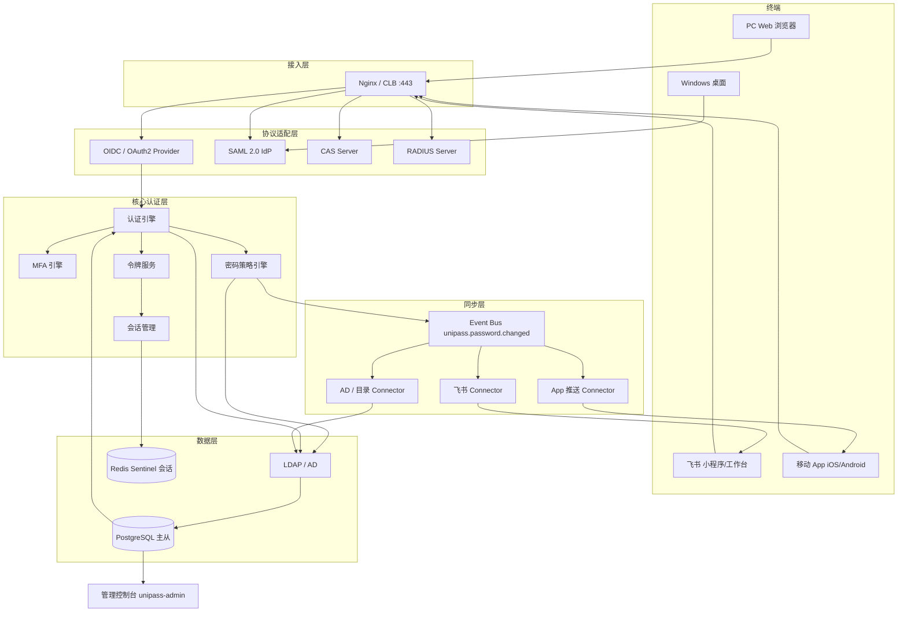

# UniPass 企业统一登录平台 — 架构设计文档

> 修订提示（2026-10-18）：本文为初版方案。实施前须结合 [设计基线与待确认事项](09-设计基线与待确认事项.md)、[技术选型](08-技术选型与决策记录.md) 和 [分任务详细设计](README.md)；冲突以修订基线为准，示例未经过部署验证。

| 项目 | 内容 |
|------|------|
| 文档编号 | UniPass-ARCH-001 |
| 文档版本 | V1.0 |
| 编制日期 | 2026-10-18 |
| 适用场景 | PC Web、Windows 桌面、飞书小程序/工作台、移动 App 统一账号与密码同步 |
| 下游文档 | 部署文档（UniPass-DEPLOY-001）、概要设计（UniPass-HLD-001）、详细设计（UniPass-LLD-001） |

**修订记录**

| 版本 | 日期 | 修订人 | 说明 |
|------|------|--------|------|
| V1.0 | 2026-10-18 | 架构组 | 首版，覆盖总体架构、关键设计决策与协议适配矩阵 |

---

## 1. 概述

### 1.1 背景

公司员工在不同终端上使用多套身份体系：PC Web 各业务系统各自维护账号、Windows 域账号、飞书成员账号、自研 App 账号。由此带来三类问题：一是重复登录与重复注册带来的体验损耗；二是同一员工存在多份身份数据，人员异动时容易残留；三是密码策略分散，一次改密只生效于单端，弱口令与长期不换密码的账号无法统一治理。

### 1.2 设计目标

实现"**一个账号，全端通行；改一次密码，所有端同步生效**"。具体拆解为四个可验证的目标：

1. **统一身份目录**：全公司只有一份员工身份数据源（LDAP/AD），所有终端身份可回溯到同一条目录记录。
2. **单点登录（SSO）**：在任一受支持终端完成一次认证后，访问其他已接入应用不再重复输入凭证。
3. **密码集中管理与同步**：密码只存储于统一目录，密码变更在秒级扩散至飞书、Windows、App 三类下游，并强制失效所有已签发会话与令牌。
4. **多协议适配**：以标准协议对外提供服务（OAuth 2.0 / OIDC / SAML 2.0 / CAS / RADIUS / LDAP），不为单个终端定制私有认证接口。

### 1.3 范围

**范围内**：身份目录建设或对接、认证与令牌服务、密码策略与变更同步、会话管理、应用（客户端）注册管理、审计日志、管理控制台、各端接入 SDK。

**范围外**：业务系统自身的权限模型（RBAC/数据权限）仍由各业务系统负责，本平台只负责"你是谁"，不负责"你能做什么"；HR 组织架构的维护仍归属 HR 系统，本平台只消费其数据。

### 1.4 术语

| 术语 | 含义 |
|------|------|
| IAM | 身份与访问管理平台，即本项目 UniPass |
| IdP | Identity Provider，身份提供者 |
| SP / RP | 信赖方 / 依赖方，即接入 IAM 的业务应用 |
| Source of Truth | 唯一权威数据源，本项目为 LDAP/AD |
| Connector | IAM 面向外部系统的同步适配器（飞书、AD、App 推送） |
| 免登 | 飞书客户端内打开应用时无需再次输入凭证即可拿到身份 |
下面按你原表格的风格补充常见 IAM 术语，可直接追加到「1.4 术语」表中。释义尽量与你的项目语境（UniPass、LDAP/AD 为 Source of Truth、飞书免登、Connector 同步）保持一致。

| 术语 | 含义 |
|------|------|
| SSO | Single Sign-On，单点登录。用户一次认证后可访问多个接入 IAM 的 SP/RP，无需重复输入凭证 |
| OIDC | OpenID Connect，基于 OAuth 2.0 的身份认证协议，IAM 作为 IdP 向 SP/RP 颁发 ID Token 以传递用户身份 |
| OAuth 2.0 | 授权框架，用于第三方应用在用户授权下获取访问令牌（Access Token），常与 OIDC 配合实现授权与认证 |
| SAML 2.0 | 基于 XML 的联邦身份认证协议，IAM 作为 IdP 与 SP 交换断言（Assertion）完成 SSO，常见于企业 SaaS 接入 |
| SCIM | System for Cross-domain Identity Management，跨域身份管理标准协议，用于 IAM 与外部系统间标准化地同步用户/组（Provisioning） |
| JIT | Just-In-Time Provisioning，即时开通。用户首次通过 SSO 登录 SP 时自动创建/更新其账号，减少预同步依赖 |
| MFA | Multi-Factor Authentication，多因素认证。结合密码、短信/OTP、推送、生物特征等多种因素提升认证强度 |
| 2FA | Two-Factor Authentication，双因素认证，MFA 的常见形式（仅两种因素） |
| RBAC | Role-Based Access Control，基于角色的访问控制。权限授予角色，角色再分配给用户/组 |
| ABAC | Attribute-Based Access Control，基于属性的访问控制。依据用户、资源、环境等属性及策略动态判定权限 |
| Provisioning | 账号开通/供应。将 Source of Truth 中的用户与组织数据同步创建到下游系统（含创建、更新、禁用） |
| Deprovisioning | 账号回收。用户离职/权限撤销时，在 downstream 系统中禁用或删除账号，常与 Provisioning 成对出现 |
| Reconciliation | 对账/校准。定期比对 IAM 与下游系统的数据差异并修正，保障同步最终一致 |
| Connector | （你表中已有）IAM 面向外部系统的同步适配器，Provisioning/Reconciliation 通常经由 Connector 执行 |
| Identity Federation | 身份联邦。跨安全域信任 IdP 的认证结果，SAML/OIDC 是实现手段 |
| Trust Relationship | 信任关系。IdP 与 SP/RP 之间预先配置的互信（如证书、Client Secret、Metadata） |
| IdP-initiated SSO | IdP 发起式单点登录。用户从 IAM 门户点击应用直接跳转 SP 完成登录 |
| SP-initiated SSO | SP 发起式单点登录。用户访问 SP 后被重定向到 IAM 认证，再返回 SP |
| Session | 会话。用户认证后在 IAM 侧保持的登录状态，SSO 与免登均依赖会话有效性 |
| Token | 令牌。认证/授权后颁发的凭证（如 ID Token、Access Token、Refresh Token），有时效与作用域 |
| Refresh Token | 刷新令牌。用于在 Access Token 过期后换取新令牌，延长会话而不要求用户重新认证 |
| Claims | 声明。令牌或断言中携带的用户属性（如 sub、email、name、部门），供 SP/RP 消费 |
| Directory | 目录服务。集中存储用户/组/组织结构的系统，本项目 Source of Truth 为 LDAP/AD |
| LDAP | Lightweight Directory Access Protocol，轻量目录访问协议，AD 等目录服务的访问协议 |
| AD | Active Directory，微软目录服务，常作为企业身份 Source of Truth |
| Group | 用户组。目录中用户的集合，常用于批量授权与下游同步 |
| OU | Organizational Unit，组织单元。LDAP/AD 中的层级组织结构，常映射为部门 |
| UPN | User Principal Name，用户主体名称，AD 中常见登录名格式（user@domain） |
| sAMAccountName | AD 传统登录名属性，常用于兼容旧系统的账号映射 |
| Distinguished Name (DN) | 专有名称。LDAP 中条目的唯一路径标识，如 cn=张三,ou=研发,dc=example,dc=com |
| ObjectGUID | AD 中用户/组的全局唯一且稳定的标识，适合同步主键 |
| Join Key | 关联键。IAM 与下游系统匹配同一用户的字段（如工号、邮箱、ObjectGUID） |
| Unique Identifier | 唯一标识。用户在主数据中的稳定 ID，用于跨系统关联与对账 |
| Identity Lifecycle | 身份生命周期。用户从入职开通、变更到离职回收的全过程管理 |
| Joiner-Mover-Leaver (JML) | 入职-调岗-离职。身份生命周期管理的典型场景，驱动 Provisioning/Deprovisioning |
| Access Request | 访问申请。用户申请某应用/角色权限的流程，常配合审批 |
| Approval Workflow | 审批流。访问申请、权限变更等需经审批人确认的流程 |
| Entitlement | 权限项。用户可被授予的具体访问权（如应用、角色、组、许可） |
| Least Privilege | 最小权限原则。仅授予完成工作所需的最小权限 |
| SoD | Separation of Duties，职责分离。防止关键权限集中于同一人，降低舞弊风险 |
| Access Review / Recertification | 权限复核/再认证。定期审查用户权限是否仍必要并回收多余权限 |
| Audit Log | 审计日志。记录认证、授权、同步、管理操作等事件，供追溯与合规 |
| SIEM | Security Information and Event Management，安全信息与事件管理，常消费 IAM 审计日志 |
| Risk-Based Authentication | 基于风险的认证。依据登录环境、设备、行为等风险动态调整认证强度 |
| Passwordless | 无密码认证。以推送、生物特征、Passkey 等替代密码 |
| Passkey | 基于 FIDO2/WebAuthn 的无密码凭证，绑定设备与生物特征 |
| WebAuthn | Web 认证标准，支持硬件密钥/生物特征进行强认证 |
| FIDO2 | 开放认证标准族，WebAuthn 为其 Web 侧规范 |
| OTP / TOTP | 一次性密码/基于时间的一次性密码，常见 MFA 因素 |
| Conditional Access | 条件访问。按用户、设备、位置、风险等条件决定是否允许访问或要求额外认证 |
| Zero Trust | 零信任。默认不信任任何访问，持续验证身份与上下文 |
| PAM | Privileged Access Management，特权访问管理，管理高权限账号与操作 |
| IGA | Identity Governance and Administration，身份治理与管理，涵盖生命周期、权限、审计 |
| CIAM | Customer Identity and Access Management，客户身份与访问管理，面向外部用户 |
| Workforce IAM | 员工身份与访问管理，面向内部员工，本项目主体 |
| Tenant | 租户。多租户场景下相互隔离的身份/数据空间 |
| Realm | 领域。认证系统内逻辑隔离的信任域 |
| Client | 客户端。OIDC/OAuth 中在 IAM 注册的 SP/RP 应用标识（Client ID/Secret） |
| Redirect URI | 回调地址。OIDC/OAuth 授权后跳回 SP 的地址，需预先注册以防劫持 |
| Scope | 作用域。OAuth 中限定令牌可访问的资源范围 |
| Consent | 授权同意。用户同意 SP/RP 获取其特定身份属性的动作 |
| Metadata | 元数据。SAML 中描述 IdP/SP 端点与证书的 XML 文档 |
| Certificate | 证书。SAML 签名/加密与 OIDC 客户端认证中用于建立信任的密钥材料 |
| Assertion | 断言。SAML 中 IdP 向 SP 声明的用户身份与属性信息 |
| ID Token | 身份令牌。OIDC 中携带用户身份 Claims 的 JWT |
| JWT | JSON Web Token，OIDC/OAuth 中常用的令牌格式 |
| Introspection | 令牌自省。SP/RP 向 IAM 查询令牌有效性与属性的接口 |
| UserInfo Endpoint | 用户信息端点。OIDC 中 SP/RP 凭 Access Token 获取用户属性的接口 |
| Discovery | 发现端点。OIDC 中 SP/RP 获取 IAM 配置（端点、能力）的元数据地址 |
| 免登 | （你表中已有）飞书客户端内打开应用时无需再次输入凭证即可拿到身份 |
| 飞书开放平台 | 提供飞书身份与组织能力的平台，免登与通讯录同步依赖其接口 |
| App 推送 | 通过移动端 App 推送方式完成认证或身份确认的通道（对应你表中 Connector 的 App 推送） |
| Webhook | 回调通知。外部系统事件（如用户变更）触发 IAM 同步的机制 |
| Polling | 轮询。IAM 定期拉取外部系统变更的同步方式 |
| Full Sync | 全量同步。一次性同步全部用户/组数据，常用于初始化或对账 |
| Incremental Sync | 增量同步。仅同步自上次以来的变更，提升效率 |
| Sync Window | 同步窗口。允许执行同步的时间段，避免影响业务 |
| Idempotency | 幂等性。同一同步操作重复执行结果一致，保障重试安全 |
| Conflict Resolution | 冲突解决。多源数据不一致时的处理策略（如以 Source of Truth 为准） |
| Data Mapping | 字段映射。Source of Truth 属性与下游系统字段的对应规则 |
| Transformation | 转换规则。同步时对属性做格式化/拼接/条件处理 |
| Filter | 同步过滤。按条件筛选需同步的用户/组（如仅同步某 OU） |
| 主数据 | Master Data。组织内被认定为权威、共享的核心数据（本项目为 LDAP/AD 中的身份数据） |
| 权威源 | （与 Source of Truth 同义）唯一可信的数据来源 |
| 下游系统 | Downstream System。从 IAM 接收身份数据的业务应用/系统 |
| 上游系统 | Upstream System。向 IAM 提供身份数据的系统，本项目为 LDAP/AD |
| 账号映射 | Account Mapping。IAM 用户与下游系统账号的对应关系维护 |
| 孤儿账号 | Orphan Account。下游系统中存在但 IAM 无对应有效用户的账号，需清理 |
| 僵尸账号 | Zombie Account。长期未使用但仍有效的账号，属安全风险 |
| 账号接管 | Account Takeover。攻击者获取他人账号控制权，MFA/风控用于防范 |
| 越权 | Privilege Escalation / Unauthorized Access。用户获得超出授权范围的访问能力 |
| 横向移动 | Lateral Movement。攻击者利用已控账号访问其他系统，零信任与最小权限用于抑制 |
| 会话固定 | Session Fixation。攻击手法，登录后应轮换会话标识防范 |
| 单点登出 | Single Logout (SLO)。一处登出后使各 SP/RP 会话同步失效 |
| 会话超时 | Session Timeout。会话空闲或最长时限后失效，需重新认证 |
| 令牌撤销 | Token Revocation。主动使令牌失效的机制，用于登出/风控 |
| 凭证 | Credential。用于证明身份的凭据（密码、证书、密钥、Passkey 等） |
| 凭据轮换 | Credential Rotation。定期更换密钥/密码以降低泄露风险 |
| 密钥管理 | Key Management。对签名/加密密钥的生成、存储、轮换与销毁管理 |
| 多租户隔离 | Tenant Isolation。不同租户间身份与数据互不可见 |
| 合规 | Compliance。满足等保、GDPR、SOX 等法规对身份与访问的要求 |
| 等保 | 网络安全等级保护，国内合规要求，对身份认证与审计有明确条款 |
| GDPR | 欧盟通用数据保护条例，涉及个人身份数据的处理与删除权 |
| PII | Personally Identifiable Information，个人可识别信息，身份数据多属此类 |
| 数据最小化 | Data Minimization。仅收集/同步业务必需的身份属性 |
| 保留策略 | Retention Policy。身份与审计数据的保存期限与销毁规则 |

几点说明，便于你落表时取舍：

1. **避免与已有条目重复**：`Connector`、`免登` 你表中已有，上表仅作引用标注，实际追加时可删去或改为「见原表」。
2. **分层建议**：若术语表不宜过长，可按「协议与标准 / 认证与会话 / 授权与治理 / 同步与生命周期 / 安全与合规」分组，或只保留与 UniPass 直接相关的（SSO、OIDC、SAML、SCIM、JIT、MFA、RBAC、ABAC、Provisioning、Reconciliation、JML、Entitlement、Audit Log、Join Key、Full/Incremental Sync、Conflict Resolution）。
3. **一致性提醒**：`Source of Truth` 定义为 LDAP/AD，而 `Connector` 含飞书/AD/App 推送——建议在正文明确「飞书/App 推送属于认证通道或下游同步目标，不作为身份权威源」，否则 `Provisioning`/`Reconciliation` 的方向（上游→下游）容易产生歧义。

需要我把这些整理成可直接粘贴的 Markdown 表格（或 CSV/JSON），或按分组拆成多张小表吗？
---

## 2. 需求与约束

**功能需求**：账号唯一性与生命周期管理；多协议认证；密码修改/重置/策略校验；跨端密码同步与会话强制失效；应用注册与回调白名单；登录与变更审计；管理员控制台。

**约束条件**（这些约束直接决定了后续设计选择）：

- 企业可能已有 Active Directory，也可能没有。架构必须同时支持"AD 作为目录"和"独立部署 OpenLDAP 作为目录"两种起点。
- 飞书侧密码写入能力受开放平台权限策略限制，部分租户只能实现"强制重新认证"而非直接改密码。架构上必须把这条链路设计为**可降级的最终一致**，而不是强一致事务。
- Windows 域内登录依赖 Kerberos，无法被 HTTP 层协议替代，因此域内一致性只能由目录（AD）本身保证。
- 需满足等保三级对审计留痕、会话超时、口令复杂度的要求。

---

## 3. 总体架构

### 3.1 分层视图

| 层级 | 组件 | 职责 |
|------|------|------|
| **接入层** | Nginx / CLB | TLS 终结、限流、静态资源、会话保持 |
| **协议适配层** | OAuth2/OIDC Provider、SAML IdP、CAS Server、RADIUS Server | 面向不同终端提供标准认证协议 |
| **核心认证层** | 认证引擎、MFA 引擎、会话管理、密码策略引擎 | 凭证校验、Token 签发、密码变更广播 |
| **身份目录层** | LDAP / Active Directory | 唯一身份数据源（Source of Truth） |
| **同步层** | 密码同步 Connector（飞书/钉钉/AD/自研 App） | 密码变更事件向外扩散 |
| **管理控制台** | 用户管理、应用管理、审计日志 | 管理员操作入口 |

### 3.2 组件拓扑

### 3.3 工程划分

| 仓库 | 内容 | 部署形态 |
|------|------|---------|
| `unipass-iam` | 核心认证服务（OAuth2/OIDC/SAML/CAS） | 无状态，2 节点起 |
| `unipass-sync` | 密码同步服务（飞书/AD/App Connector） | 独立部署，消费事件总线 |
| `unipass-admin` | 管理控制台前端 | Nginx 静态 |
| `unipass-portal` | 统一登录页前端（登录/改密/重置） | Nginx 静态 |
| `unipass-sdk-web` | PC Web 接入 SDK | 库 |
| `unipass-sdk-mobile` | 移动 App 接入 SDK | 库 |
| `unipass-sdk-windows` | Windows 凭证提供程序 | 客户端安装包 |
| `unipass-infra` | 部署脚本、Helm、Terraform | — |

---

## 4. 关键设计决策

### 4.1 身份唯一性

以 HR 系统员工号或 AD `sAMAccountName` 作为全局唯一标识（`employeeNumber`），所有终端均映射至同一 LDAP DN。

- IAM 内部主键 `iam_user.id` 与目录 DN 解耦：目录 DN 可变（人员调整组织单元），内部 ID 不变，保证历史审计日志可追溯。
- 下游系统各自的 user id（飞书 `open_id`/`user_id`、App 账号 id）作为**映射关系**存储，不进入身份判定逻辑。
- 冲突处理原则：导入阶段以 `employeeNumber` 做唯一键去重，重复记录进入人工核对队列，不做静默合并。

### 4.2 "一处修改，处处生效"的实现路径

这是本项目架构的核心，按终端类型分四条链路，一致性强度不同：

| 终端 | 链路 | 一致性强度 | 说明 |
|------|------|-----------|------|
| PC Web / 飞书小程序 | 密码修改调用 IAM `Password Change API` → 写入 LDAP → 触发事件 | 强一致（目录写入成功才返回成功） | 认证完全走 IAM，改密即生效 |
| Windows 桌面 | AD 域控集成：IAM 直接对接 AD（或 LDAP + Winlogon 凭证提供程序 / AD FS） | 强一致 | AD 作为目录时，密码本就在同一份数据上，天然一致 |
| 飞书 | IAM 在密码变更事件中调用飞书 API 更新成员密码，或强制该成员重新认证 | 最终一致（异步 + 重试 + 对账） | 受开放平台权限限制，允许降级 |
| 移动 App | App 走 OIDC 授权码流程；改密后所有 refresh_token 被吊销，App 收到推送清除本地 token | 最终一致（下次请求强制重认证） | 无需把密码下发到 App 后端 |

**为什么域内 Windows 不依赖 IAM 在线可用**：域内 Kerberos 认证直接命中 AD，IAM 不可用时员工仍能登录 Windows。这是刻意设计的可用性隔离——IAM 故障不应导致全员无法开机。代价是 IAM 侧的 MFA、风控策略在域内 Kerberos 路径上不生效，需通过 AD FS 表单登录路径覆盖。

### 4.3 会话与 Token 失效

密码修改后，IAM 发布 `password.changed` 事件，所有在线会话（Redis 中存储的 session/token）立即失效，各端下次请求时被重定向至登录页。

失效采用**三重保险**，避免单点失效导致旧令牌长期可用：

1. **主动清除**：会话服务删除 Redis 中该用户的 session 与 refresh token 记录。
2. **版本号校验**：`iam_user` 维护 `password_changed_at`，网关校验 access token 时比对其 `iat` 与密码变更时间，早于变更时间的 JWT 一律拒绝（即使尚未过期）。这一条解决了无状态 JWT 无法即时吊销的问题。
3. **推送通知**：App 推送 Connector 通知客户端主动清空本地凭证，改善体验（非安全依赖项）。

### 4.4 密码存储边界

明文密码只在 TLS 通道内短暂存在，IAM 不额外持久化一份密码副本。密码哈希由目录服务持有（AD 使用 NTLM/Kerberos 密钥，OpenLDAP 使用 SSHA256/SSHA512）。IAM 数据库中的 `iam_user` 表**不存储密码字段**，从架构上消除"两处密码不一致"这一类问题。

### 4.5 同步采用事件驱动而非分布式事务

跨端密码同步不引入 XA/TCC。理由：飞书 API、推送服务均为外部系统，其可用性不可控，强事务会让改密接口整体不可用。改为：改密接口只做目录写入（同步、强一致）+ 事件投递（本地消息表落地，同一事务内写 `sync_task`），投递后由 `unipass-sync` 异步消费，失败重试 + 定时对账兜底。改密接口的响应时间不受下游影响。

---

## 5. 协议适配矩阵

| 终端 | 认证协议 | 备注 |
|------|---------|------|
| PC Web | OIDC / OAuth 2.0 | 浏览器重定向至 IAM 登录页 |
| Windows 桌面 | Kerberos / LDAP / AD FS | 域内走 Kerberos，域外走 AD FS 表单 |
| 飞书 | OAuth 2.0（飞书开放平台）+ IAM OIDC | 飞书扫码/免登 → IAM 校验 → 返回用户身份 |
| 移动 App | OIDC + PKCE | App 内安全存储 refresh_token |
| 传统/内网系统 | CAS 1.0/2.0/3.0 | 存量老系统迁移成本低 |
| VPN / 网络设备 | RADIUS | 复用同一目录凭证 |

新增一类终端时，只允许通过"注册客户端 + 选择已有协议"的方式接入，不允许为其扩展新的认证引擎。这是控制核心复杂度的架构红线。

---

## 6. 数据架构

| 存储 | 承载数据 | 一致性要求 |
|------|---------|-----------|
| LDAP / AD | 身份、凭证、组织归属 | Source of Truth，最高 |
| PostgreSQL | `iam_user`（目录镜像 + 映射）、`sync_task`、`audit_log`、应用注册 | 强一致，主从复制 |
| Redis（Sentinel） | 会话、授权码、tenant_access_token 缓存、限流计数 | 允许丢失（重建即重新登录） |
| 对象存储 / 日志系统 | 审计日志归档（≥6 个月） | 只追加 |

PostgreSQL 是目录的**派生副本**而非权威源，任何数据冲突以 LDAP 为准。核心表模型见详细设计文档 §数据模型。

---

## 7. 安全设计

- **传输**：全链路 TLS 1.2+，HSTS 开启，禁用弱套件；内部服务间亦启用 mTLS 或专线。
- **OAuth 防护**：`redirect_uri` 精确匹配；Web 端强制 `state`；移动端/PKCE 强制 `S256`；`authorization_code` 一次性使用、TTL 60 秒。
- **令牌**：access token 短时效（默认 3600 秒），refresh token 与设备指纹绑定并支持轮换（rotation + reuse detection）。
- **密码接口防暴力破解**：按账号 + IP 双维度限流，连续失败触发图形验证码 → 临时锁定；锁定策略与审计联动。
- **MFA**：认证引擎内可插拔（OTP / 飞书确认 / 硬件密钥），按应用与用户分组配置豁免。
- **管理面**：控制台与管理 API 独立监听与鉴权，特权操作二次认证，全部落审计。
- **密钥管理**：JWT 签名密钥支持在线轮换与 `kid` 多版本并存，私钥不进代码库。

---

## 8. 高可用与容量

| 维度 | 方案 | 目标 |
|------|------|------|
| 应用层 | 无状态双节点 + LB 健康检查摘流 | 单节点故障 30 秒内恢复 |
| 目录层 | LDAP 主从复制；AD 多域控 | 主宕机可从节点提升接管 |
| 会话层 | Redis Sentinel 三节点 | 自动主从切换 |
| 数据层 | PostgreSQL 主从流复制 + 归档备份 | RPO ≤ 5 分钟 |
| 事件层 | `sync_task` 本地消息表保证不丢 | 至少一次投递 + 幂等消费 |

容量基线（生产）按 5000 员工、峰值 50 次认证/秒、日均登录 3 万次设计，改密峰值按每日 100 次冗余。

---

## 9. 非功能指标（验收口径）

| 指标 | 目标 |
|------|------|
| 认证接口 P99 延迟 | ≤ 300 ms（不含浏览器跳转） |
| 密码改密接口 P99 | ≤ 800 ms |
| 密码变更 → 飞书同步完成 | P95 ≤ 30 秒，P99 ≤ 5 分钟 |
| 密码变更 → 旧会话失效 | ≤ 5 秒 |
| 服务可用性 | ≥ 99.9%（月） |
| 审计日志保留 | ≥ 6 个月 |

---

## 10. 风险与备选方案

| 风险 | 影响 | 缓解 / 备选 |
|------|------|------------|
| 飞书不允许直接写密码 | 飞书端"改一次密码全端生效"无法强达成 | 降级为"强制重新认证"，在验收文档 A5 中明确通过标准 |
| 无 AD 的企业需自建 OpenLDAP 支撑 Windows 登录 | 部署周期与桌面改造成本上升 | 备选：仅覆盖 Web/飞书/App 三端，Windows 维持现状并在文档中标注范围 |
| IAM 成为登录单点 | IAM 故障导致 Web/App 无法登录 | LB 双节点 + 目录多副本；Windows 域内 Kerberos 保持独立可用 |
| 存量系统迁移阻力 | SSO 覆盖率长期无法达标 | 提供 CAS/OIDC/SAML 三套适配 + 接入 SDK，按批次灰度迁移 |

**备选方案（自建 vs 商用）**：若企业优先级是"尽快覆盖"而非"可控与合规自主"，可选用成熟商用 IDaaS 承担协议层，本项目退化为"目录 + 同步 Connector + 控制台"。架构上两者可平滑替换——协议适配层接口即标准 OIDC/SAML，业务应用不感知实现方。本文档按自建路线展开。

---

## 11. 文档关系

- 本文档（§架构设计）决定部署文档的拓扑与环境规格，以及概要设计的模块划分。
- 概要设计 → 详细设计 → PM 任务分解（T2–T8 对应本文档 §3.1 的核心认证层与同步层）。
- 验收文档以详细设计的接口与本文档 §9 的非功能指标为测试基准。
- 运维 SOP 承接生产运行，重点覆盖本文档 §4.2 的跨端密码同步链路。
