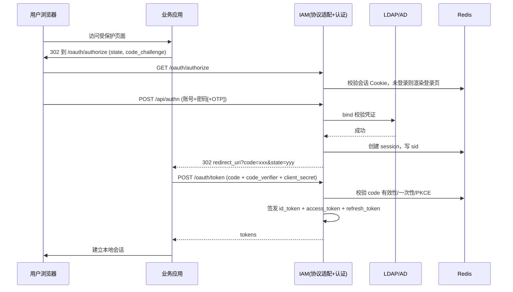
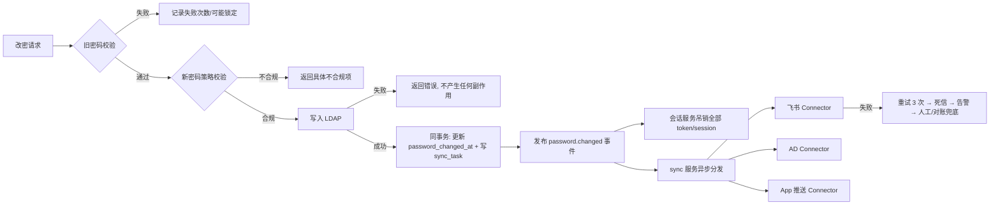

# UniPass 企业统一登录平台 — 概要设计文档

> 修订提示（2026-10-18）：本文为初版方案。实施前须结合 [设计基线与待确认事项](09-设计基线与待确认事项.md)、[技术选型](08-技术选型与决策记录.md) 和 [分任务详细设计](README.md)；冲突以修订基线为准，示例未经过部署验证。

| 项目 | 内容 |
|------|------|
| 文档编号 | UniPass-HLD-001 |
| 文档版本 | V1.0 |
| 编制日期 | 2026-10-18 |
| 上游文档 | 架构设计文档（UniPass-ARCH-001） |
| 下游文档 | 详细设计文档（UniPass-LLD-001） |

**修订记录**

| 版本 | 日期 | 修订人 | 说明 |
|------|------|--------|------|
| V1.0 | 2026-10-18 | 设计组 | 首版，覆盖模块划分、核心流程与公共设计约定 |

---

## 1. 设计范围与原则

概要设计把架构文档的六个层次落到可开发的模块粒度。遵循三条原则：

1. **认证与同步分离**：`unipass-iam` 只负责"验证与签发"，`unipass-sync` 只负责"向外扩散"。同步链路故障绝不影响登录与改密接口的可用性。
2. **目录优先**：任何写操作先落 LDAP，成功后才更新本地派生数据与投递事件。
3. **协议适配不侵入认证逻辑**：OIDC/SAML/CAS/RADIUS 是同一认证引擎的不同"外壳"，凭证校验代码只有一份。

---

## 2. 核心模块划分

| 模块 | 功能 | 对外接口 | 所属仓库 |
|------|------|---------|---------|
| 认证服务 | 用户名密码、OTP、扫码登录 | `/oauth/authorize`、`/api/authn` | `unipass-iam` / `iam-authn` |
| 令牌服务 | JWT 签发、刷新、吊销 | `/oauth/token`、`/oauth/revoke` | `unipass-iam` / `iam-token` |
| 密码服务 | 密码修改、重置、策略校验 | `/api/password/change` | `unipass-iam` / `iam-password` |
| 会话服务 | 会话创建、查询、强制失效 | 内部 + `/oauth/logout` | `unipass-iam` / `iam-session` |
| 同步服务 | 密码变更事件分发至飞书/AD/App | 内部 Event Bus | `unipass-sync` |
| 应用管理 | 客户端注册、回调白名单 | `/admin/apps` | `unipass-iam` / `iam-app` |
| 审计服务 | 登录日志、密码变更日志 | `/admin/audit` | `unipass-iam` / `iam-audit` |
| 协议适配 | OIDC / SAML / CAS / RADIUS 端点 | `/oauth/*`、`/saml/*`、`/cas/*` | `unipass-iam` / `iam-protocol` |
| 门户前端 | 登录页、改密页、重置页 | 静态 | `unipass-portal` |
| 控制台前端 | 用户/应用/审计管理 | 静态 + admin API | `unipass-admin` |

模块间只允许通过上表接口或事件总线交互，禁止跨模块直接访问对方数据表。

---

## 3. 关键流程设计

### 3.1 OIDC 授权码登录（PC Web / App）



关键约束：授权码 TTL 60 秒、一次性；`redirect_uri` 与注册值精确匹配；`state` 必须校验；会话 Cookie 为 `HttpOnly Secure SameSite=Lax`。

### 3.2 密码修改与跨端同步流程（概要）

1. 用户在任意端发起修改密码（门户改密页 / App 内改密 / 管理员重置）。
2. IAM 校验旧密码 → 校验新密码复杂度 → 写入 LDAP。
3. 写入成功后，IAM 在同一数据库事务内：更新 `iam_user.password_changed_at`、写入 `sync_task` 待办记录（本地消息表），并提交。
4. 提交成功后发布 `PasswordChangedEvent`（含 userId、事件 id、时间戳）。
5. **同步服务**消费事件：
   - 调用飞书 API 更新对应成员密码（或强制该成员在飞书端重新认证）。
   - 若 Windows 走 AD FS：AD 密码已随 LDAP 更新（AD 作为目录时天然一致）。
   - 调用移动 App 推送服务，通知 App 清除本地 token。
6. **会话服务**吊销该用户所有 Refresh Token 和 Session。
7. 各端下次请求时发现令牌失效，被重定向至登录页。



**顺序性说明**：会话吊销（G）先于外部同步完成。这是刻意的安全取向——宁可飞书端晚 5 分钟生效，也不能让旧会话在改密后继续可用。

### 3.3 飞书免登流程

1. 飞书工作台内点击应用 → 前端获取临时 `tmp_code`（jsapi `tt.requestAuthCode`）。
2. 前端将 `tmp_code` 提交给业务后端 → 后端调用 IAM。
3. IAM 用 `app_access_token` 换取飞书用户身份（`user_id`/`open_id`）。
4. IAM 查映射表 `iam_user_external_binding` → 找到对应 `employeeNumber` → 定位 LDAP DN。
5. 若该 IAM 账号已有有效 SSO 会话，直接签发 code 回跳（真正免登）；否则重定向至登录页完成一次账号绑定。
6. 映射缺失时进入"绑定引导"流程，要求员工用统一账号登录一次，之后长期免登。

### 3.4 Windows 登录一致性

| 模式 | 认证路径 | 改密生效方式 |
|------|---------|-------------|
| A（AD 作目录） | 客户机 → KDC(Kerberos) | 同一 AD，改密即一致，无需同步 |
| B（AD FS 联合） | 客户机浏览器 → AD FS → IAM SAML | IAM 会话失效后重新认证 |
| C（凭证提供程序） | Winlogon → `unipass-sdk-windows` → LDAP bind | 在线时目录直连；离线依赖缓存策略 |

模式 C 需明确离线登录策略（建议：允许最近一次成功登录的本地缓存凭证，且缓存仅在设备受控且加密时启用）。

---

## 4. 状态与数据流设计

### 4.1 同步任务状态机

```
PENDING ──► RUNNING ──► SUCCESS
                │
                ├──► FAILED ──(retry_count < 3)──► PENDING
                │                └─(retry_count ≥ 3)─► DEAD
                └──► SKIPPED（目标系统不适用于该用户）
```

`DEAD` 状态任务不自动清理，进入运维 SOP 的人工处理队列，并由每日对账任务重新生成。

### 4.2 令牌生命周期

| 对象 | 存储 | TTL | 吊销方式 |
|------|------|-----|---------|
| authorization code | Redis | 60 s | 用后即删 |
| access token（JWT） | 客户端 | 3600 s | 逻辑吊销：`password_changed_at` 时间戳比对 |
| refresh token | Redis + DB 记录 | 30 d | 删除记录 + 会话组失效 |
| SSO 会话 | Redis | 8 h（滑动） | 删除 session key |
| 飞书 tenant_access_token | Redis | 2 h（提前 5 分钟刷新） | 过期自然失效 |

无状态 JWT 无法物理撤回，因此引入 `pwd_version`（即 `password_changed_at` 秒级时间戳）写入 token claim，网关侧比对目录当前值。这是设计层面解决"改密即时失效"的关键补偿机制。

---

## 5. 公共设计约定

- **统一响应结构**：`{ "code": 0, "message": "ok", "data": {...}, "trace_id": "..." }`；认证端点须遵循 OAuth 规范返回 `error`/`error_description`（不与业务结构混用）。
- **错误码分段**：`40xxx` 客户端凭证类、`41xxx` 密码策略类、`42xxx` 账号状态类、`43xxx` 流量控制类、`50xxx` 服务端、`51xxx` 下游同步。详见详细设计文档 §8。
- **幂等**：所有写接口支持 `X-Request-Id` 幂等键，有效期 24 小时；Connector 消费以事件 id 去重。
- **限流**：按 IP + 账号双维度；认证接口全局令牌桶，改密接口每账号 1 次/分钟。
- **审计**：登录、登出、改密、重置、管理操作五类事件强制记录，异步写入但失败重试，不允许静默丢弃。
- **可观测**：`trace_id` 贯穿 IAM → 事件总线 → Connector → 飞书调用日志。
- **时区与时间**：全部 UTC 存储，展示层转本地时区；Kerberos 依赖的节点时钟由统一部署文档 §1.3 保证。

---

## 6. 与详细设计的对应

| 概要模块 | 详细设计章节 | PM 任务 |
|---------|-------------|--------|
| 认证/令牌/协议 | LLD §2 认证接口 | T2 |
| 密码服务 | LLD §3.1–3.2 接口 + §3.3 策略规则 | T3 |
| 会话服务 | LLD §2.4 登出吊销 + §5.2 缓存设计 | T2 |
| 同步服务 / 飞书 | LLD §4.1–4.4 + §5.3 事件契约 | T5 |
| 应用管理 / 审计 | LLD §4.5 管理接口 + §5.1 数据模型 | T8 |
| Windows | LLD §7.1 | T4 |
| App SDK | LLD §7.2 | T6 |
| PC Web / 门户 | LLD §7.3 | T7 |
| 错误码与重试 | LLD §8 / §9 | T2–T8 共用 |
